# Entity-Relationship (ER) Diagram & Relational Mapping
> **PRD Section 18 Deliverable**  
> System: **B2B Wholesale Distribution & Demand Intelligence Network**

---

## 1. Conceptual Mermaid ER Diagram

```mermaid
erDiagram
    USERS ||--o| RETAILER : "authenticates"
    RETAILER ||--o{ ORDERS : "places"
    RETAILER ||--o{ PAYMENT : "remits"
    RETAILER ||--o{ LEDGER_ENTRY : "owns balance"
    RETAILER ||--o{ REVIEW : "writes"

    BRAND ||--o{ PRODUCT : "manufactures"
    PRODUCT ||--o{ SKU : "offers variants"
    PRODUCT ||--o| SPEC_SHEET : "described by"
    PRODUCT ||--o{ REVIEW : "evaluated in"

    SPEC_SHEET ||--o{ SPEC_EMBEDDING : "chunked into"
    REVIEW ||--o| REVIEW_EMBEDDING : "vectorized as"

    WAREHOUSE ||--o{ INVENTORY : "stores"
    SKU ||--o{ INVENTORY : "stocked in"
    INVENTORY ||--o{ LOW_STOCK_ALERT : "triggers"

    ORDERS ||--o{ ORDER_ITEM : "contains"
    SKU ||--o{ ORDER_ITEM : "ordered in"
    WAREHOUSE ||--o{ ORDER_ITEM : "dispatched from"
    WAREHOUSE ||--o{ ORDERS : "primary shipping hub"
    ORDERS ||--o{ PAYMENT : "settled by"

    USERS {
        int user_id PK
        string email UK
        string password_hash
        string role
        boolean is_active
    }

    RETAILER {
        int retailer_id PK
        int user_id FK
        string business_name
        string gstin UK
        string region
        decimal credit_limit
        decimal outstanding_balance
    }

    BRAND {
        int brand_id PK
        string brand_name UK
        string country_of_origin
    }

    PRODUCT {
        int product_id PK
        int brand_id FK
        string model_name
        int release_year
    }

    SKU {
        int sku_id PK
        int product_id FK
        string sku_code UK
        int ram_gb
        int storage_gb
        string color
        decimal wholesale_price
    }

    SPEC_SHEET {
        int spec_id PK
        int product_id FK
        text spec_text
        text thermal_specs
        text camera_specs
        text display_specs
        text battery_specs
    }

    WAREHOUSE {
        int warehouse_id PK
        string warehouse_name
        string city
        string region
        int capacity
    }

    INVENTORY {
        int warehouse_id PK, FK
        int sku_id PK, FK
        int quantity_on_hand
        int reorder_threshold
    }

    LOW_STOCK_ALERT {
        int alert_id PK
        int warehouse_id FK
        int sku_id FK
        int threshold_value
        int current_quantity
        string status
    }

    ORDERS {
        int order_id PK
        int retailer_id FK
        string status
        decimal total_amount
        string payment_status
        int shipping_warehouse_id FK
    }

    ORDER_ITEM {
        int order_id PK, FK
        int line_no PK
        int sku_id FK
        int warehouse_id FK
        int quantity
        decimal unit_price
        decimal line_total
    }

    PAYMENT {
        int payment_id PK
        int retailer_id FK
        int order_id FK
        decimal amount
        string payment_method
        string reference_no
    }

    LEDGER_ENTRY {
        int ledger_id PK
        int retailer_id FK
        string entry_type
        decimal amount
        decimal balance_after
        string reference_type
    }

    SPEC_EMBEDDING {
        int embedding_id PK
        int spec_id FK
        string chunk_category
        text chunk_text
        vector embedding
        jsonb metadata
    }

    REVIEW {
        int review_id PK
        int retailer_id FK
        int product_id FK
        int rating
        text review_text
    }

    REVIEW_EMBEDDING {
        int review_id PK, FK
        text chunk_text
        vector embedding
        string region
    }
```

---

## 2. ER-to-Relational Mapping & Referential Integrity Rules

1. **Weak Entity Mapping (`order_item`)**:
   - `order_item` has no independent existence without `orders`.
   - Primary key is composite: `(order_id, line_no)`.
   - Foreign key constraint: `FOREIGN KEY (order_id) REFERENCES orders(order_id) ON DELETE CASCADE`.

2. **Many-to-Many Intersection Entity (`inventory`)**:
   - Models the $M:N$ relationship between `warehouse` and `sku`.
   - Primary key is composite: `(warehouse_id, sku_id)`.
   - Cascade policy: `ON DELETE RESTRICT` protects against deleting warehouses or SKUs with active stock.

3. **Composite Foreign Key (`low_stock_alert`)**:
   - Points to the composite primary key of `inventory`:
   - `FOREIGN KEY (warehouse_id, sku_id) REFERENCES inventory(warehouse_id, sku_id) ON DELETE CASCADE`.

4. **One-to-One Relationships**:
   - `users` to `retailer`: `retailer.user_id` is declared `UNIQUE` and `NOT NULL`.
   - `product` to `spec_sheet`: `spec_sheet.product_id` is declared `UNIQUE` and `NOT NULL`.
   - `review` to `review_embedding`: `review_embedding.review_id` is both `PRIMARY KEY` and `FOREIGN KEY`.

5. **Financial Immutability & Audit Safeguards**:
   - `ledger_entry` is strictly append-only.
   - Deletion rules on financial links (`retailer`, `payment`, `ledger_entry`) are strictly enforced via `ON DELETE RESTRICT`.
